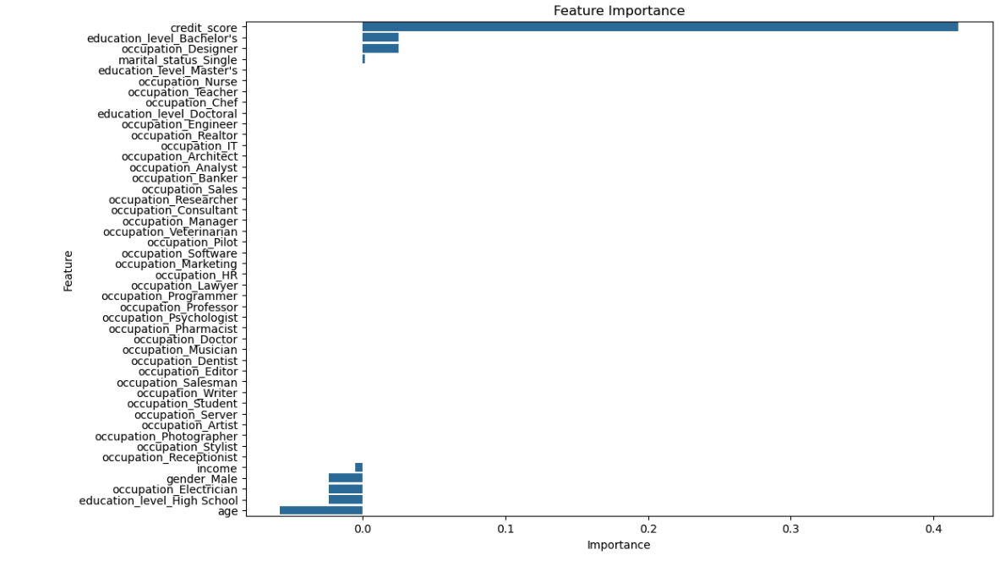

# 🏦 Loan Approval Prediction with Logistic Regression (Python Project)

## 📌 Project Overview

This project builds a machine learning model in Python that predicts whether a loan application will be approved or denied. It uses logistic regression, a common classification method, in a Jupyter Notebook.

The dataset has 61 loan applicants with their age, gender, occupation, education level, marital status, income, credit score, and final loan decision. The project covers data checks, encoding, model training, evaluation, cross-validation, and a prediction for a new applicant.

## 🎯 Key Features

✅ Data Inspection: Checked the structure, data types, and missing values with pandas. 
✅ One-Hot Encoding: Turned text columns (gender, occupation, education, marital status) into numeric columns with `get_dummies`. 
✅ Train/Test Split: Held back 20% of the data to test the model on applicants it had not seen. 
✅ Logistic Regression Model: Trained a scikit-learn classifier to predict loan denial. 
✅ Model Evaluation: Measured accuracy, a confusion matrix, and a classification report. 
✅ Cross-Validation: Tested the model across 5 different splits to check that results hold up. 
✅ New Applicant Prediction: Scored a sample applicant and returned "Approved" or "Denied." 
✅ Feature Coefficient Chart: Plotted the weight the model gave each feature.

## 📷 Visualizations

### Feature Coefficients

*The model predicts the chance of denial. A bar to the right pushes toward denial, and a bar to the left pushes toward approval. The features were not scaled, so bar length is not a fair comparison across features. See the note under Key Insights.*

## 🗂️ Repository Files

| File | Description |
|------|-------------|
| `loan.csv` | Raw dataset: 61 rows and 8 columns (age, gender, occupation, education_level, marital_status, income, credit_score, loan_status) |
| `loan_approval_prediction.ipynb` | Jupyter Notebook with the full code, model, and outputs |
| `feature_importance.png` | Bar chart of the model's feature coefficients |

## 🧹 Data Preparation

- Loaded the data with `pd.read_csv()` using a relative file path, so the notebook runs from any computer.
- Checked data types: 3 numeric columns and 5 text columns.
- Confirmed the dataset has no missing values and no duplicate rows.
- Used `pd.get_dummies(drop_first=True)` to encode text columns, which grew the data to 47 columns.
- Set `loan_status_Denied` as the target and all other columns as features.
- Split the data 80/20 into training and test sets with `random_state=42` so results can be repeated.

## 🛠️ Skills & Tools Applied

- Language and Environment: Python, Jupyter Notebook (Anaconda)
- Libraries: pandas, NumPy, scikit-learn, Matplotlib, Seaborn
- scikit-learn Tools: `train_test_split`, `LogisticRegression`, `accuracy_score`, `confusion_matrix`, `classification_report`, `cross_val_score`
- Data Preparation: One-hot encoding, feature and target selection
- Data Storytelling: Explaining model results and their limits in plain language

## 📈 Business Questions Answered

This project provides insights into:

- Can a simple model predict loan decisions from applicant details?
- How well does the model perform on applicants it has not seen?
- Which applicant traits separate approved and denied applications?
- Would a sample applicant be approved?

## 💡 Key Insights

- The dataset had **45 approved** (74%) and **16 denied** (26%) applications.
- The model scored **100% accuracy** on the 13-applicant test set. It correctly labeled all 9 approvals and all 4 denials.
- **5-fold cross-validation** averaged **96.7% accuracy** (scores of 100%, 92%, 92%, 100%, and 100%). This shows the model performs well on different slices of the data, not just one lucky split.
- **Income** separated the groups cleanly. Every denied applicant earned **$52,000 or less** (average $39,688). Every approved applicant earned **$55,000 or more** (average $92,956).
- **Credit score** told a similar story. Denied applicants scored 560 to 660 (average 611). Approved applicants scored 650 to 830 (average 745).
- **No married applicant was denied** (0 of 37). All 16 denials went to single applicants.
- **No applicant with a master's or doctoral degree was denied** (0 of 25). Six of the 7 high school applicants were denied.
- A sample applicant (age 35, single male engineer, bachelor's degree, $80,000 income, 650 credit score) was predicted to be **Approved**.

*Note: The dataset is small (61 rows) and the two groups are almost perfectly separated, so high accuracy is expected here and would likely be lower on real lending data. The coefficient chart should be read with care. Income is measured in dollars and credit score in points, so their raw coefficients are not on the same scale. Income and credit score also rise together, which makes the credit score coefficient's direction hard to interpret alone. Scaling the features first would give a fairer comparison.*

## 🚀 Learning Outcomes

Building this project strengthened my skills in:

📌 Preparing categorical data for machine learning with one-hot encoding 
📌 Splitting data into training and test sets 
📌 Training and using a logistic regression classifier 
📌 Reading a confusion matrix and classification report 
📌 Using cross-validation to check that a model's results hold up 
📌 Spotting the limits of a model, such as small samples and unscaled features

## 🔮 Next Steps

- Scale the numeric features with `StandardScaler` so coefficients can be compared fairly.
- Test the model on a larger, real-world lending dataset.
- Compare logistic regression with a decision tree or random forest.
- Add a confusion matrix heatmap and a ROC curve to the visuals.

## 📚 Dataset Source

Practice dataset of 61 loan applicants, provided for this learning project.

## 🙌 Acknowledgment

This project was my first step into machine learning. It took me from raw data to a working model that makes predictions, and it showed me why checking a model's limits matters as much as its accuracy score.

## 🔗 Related Link

[LinkedIn Post](https://www.linkedin.com/in/YOUR-POST-LINK)

## 👨‍💻 Author

**Omar Shazley**: Data Analyst | Python, Excel, SQL, and healthcare data analytics

💼 [LinkedIn](https://www.linkedin.com/in/omar-shazley-914a16b1/) 
📧 Email: [omarshazley@gmail.com](mailto:omarshazley@gmail.com)

✨ If you like this project, don't forget to ⭐ star the repo!
